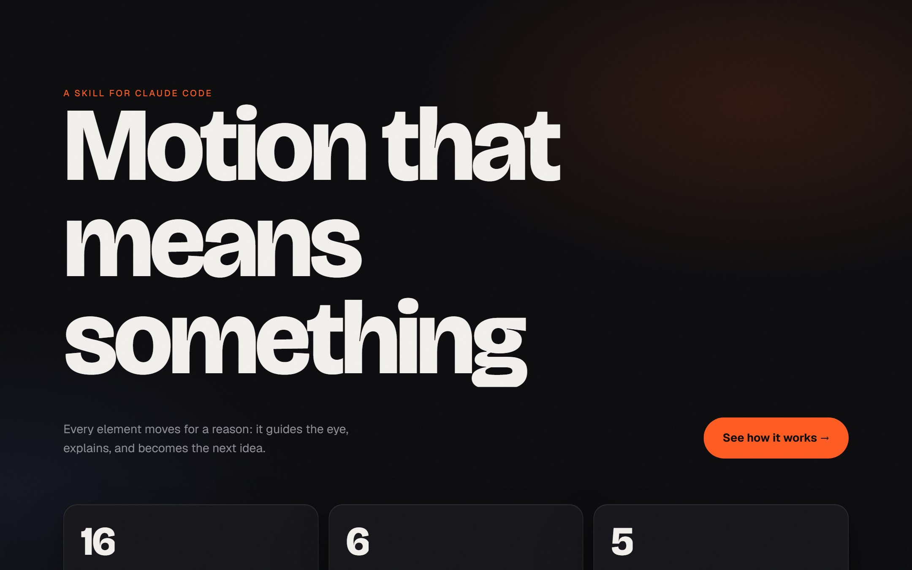
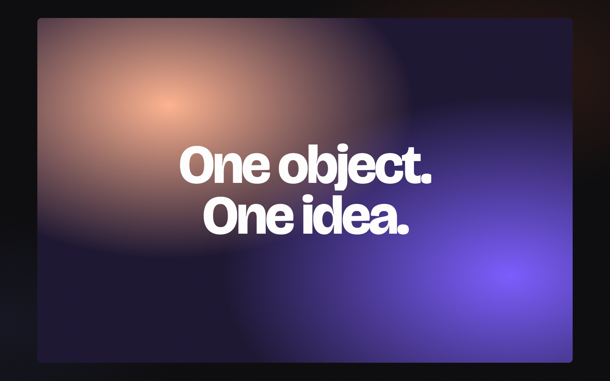
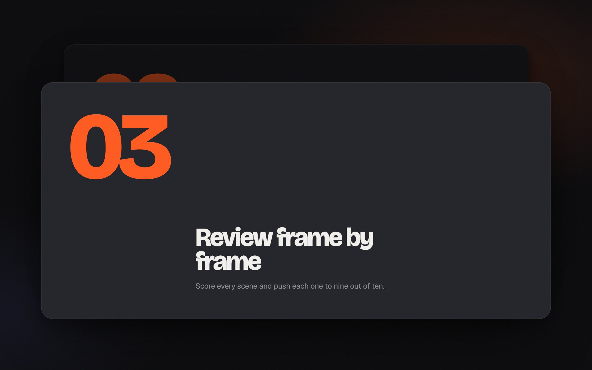
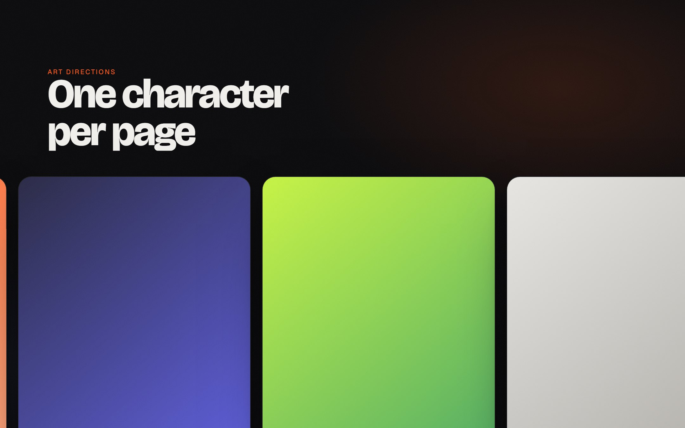
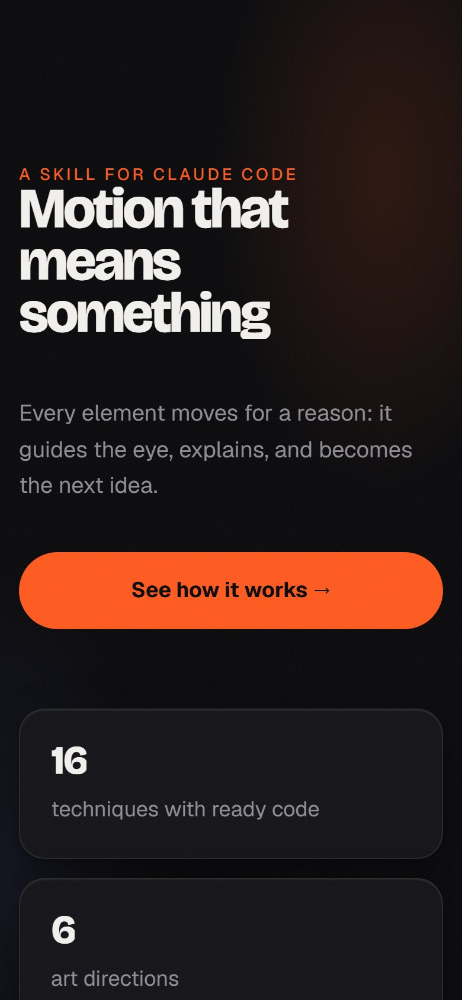
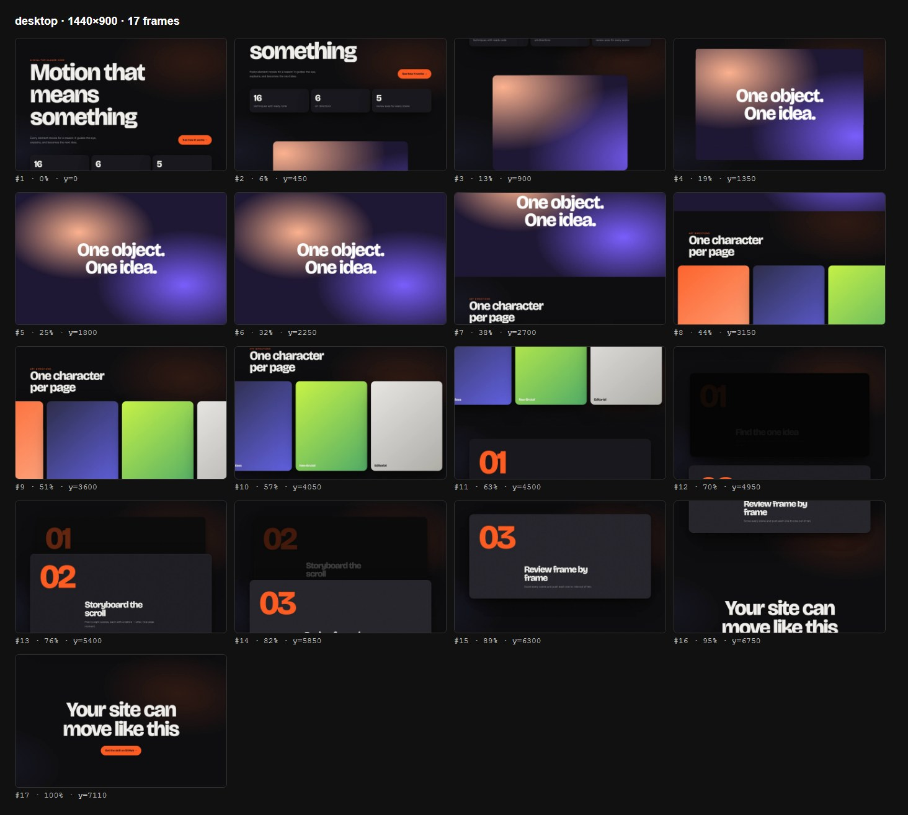

<div align="center">

# motion-site

### Motion that means something.

A Claude Code skill that turns Claude into a motion design studio.<br>
Art direction → scroll storyboard → build → **frame-by-frame self-review until every scene scores 9/10.**

[**Live demo**](https://ildargiv.github.io/motion-site/) · [Install](#install) · [Example prompts](#example-prompts) · [How it works](#how-it-works) · [What's inside](#whats-inside)



</div>

---

## Why this skill

Ask any AI for "a landing page with animations" and you get the same thing: centered text on a gradient, everything fading in at once, a bounce here and there. It looks generated because it *is* generated: effects with no reason behind them.

**motion-site gives Claude a method, not a list of effects.** It works the way a motion studio does, and it checks its own work.

| What you usually get | What you get with motion-site |
|---|---|
| Effects added "to look nice" | Every movement answers *"where do I look, and what just changed?"* |
| Everything fades in at once | Words rise out of masks 0.09s apart; numbers roll like an odometer |
| Transitions via fade-to-black | The object itself becomes the next scene: push-ins, reveals, morphs |
| Every section equally loud | A storyboard with rhythm and exactly one peak moment |
| "Done!" without ever looking | Screenshots on desktop and mobile, 5-axis scoring, fix the 3 worst spots, repeat |

<table>
<tr>
<td width="50%"><br><sub><b>Portal.</b> A card opens to full screen and becomes the next scene.</sub></td>
<td width="50%"><br><sub><b>Card stack.</b> The previous card sinks back as the next one slides over it.</sub></td>
</tr>
<tr>
<td width="50%"><br><sub><b>Horizontal rail.</b> Vertical scroll drives a pinned rail with parallax inside each card.</sub></td>
<td width="50%" align="center"><br><sub><b>Mobile, done right.</b> No horizontal pins, native snap scrolling, readable at 390px.</sub></td>
</tr>
</table>

## Everything it gives you

### 🎬 A real studio process
- **Brief in one message.** At most four questions, only about what you didn't already say. No interrogation.
- **Art direction first.** Six complete directions — Midnight Launch, Editorial, Swiss Kinetic, Warm Craft, Liquid Glass, Neo-Brutal — each with a palette, a type pairing, a motion character, and a signature move. One page, one character.
- **A scroll storyboard before any code.** 5–8 scenes, each with one idea and a *before → after*, calm/active rhythm, and exactly one peak moment.

### 🔁 A built-in self-review loop
- **It looks at its own work.** A bundled script captures the page at every scroll step on desktop (1440×900) and mobile (390×844) and assembles a contact sheet.
- **It grades itself honestly.** Every scene is scored 1–10 on five axes: idea, composition, motion, typography, rhythm — with a written rubric of what 5, 7, and 9 look like.
- **It fixes what's worst.** The three weakest spots get fixed, then it shoots again — until every scene hits 9+ or the score stops improving.
- **It catches the boring bugs too.** Console errors, horizontal overflow, text under 14px on mobile, content hidden under reduced motion.


<sub>The contact sheet the skill shoots of its own demo page. This is what Claude looks at before it's allowed to say "done".</sub>

### ✨ Motion that feels expensive
- **Masked text reveals** with GSAP SplitText — words rise out of line masks, re-split automatically on resize.
- **Odometer numbers** that roll and settle right to left, with each column sized to its digit.
- **Portal push-ins**, **horizontal rails**, **sticky card stacks**, and **11 more techniques** with ready code: image reveals, read-along text, sticky swaps, theme shifts, line drawing, velocity marquees, 3D layer explodes, chart morphs, magnetic buttons, light sweeps, Flip layout transitions.
- **A precise motion grammar:** `expo.out` enters, exits twice as fast, springs that settle without bouncing, 0.09s word staggers, results that hold while they're read.
- **Buttery scrolling** with Lenis, synced to ScrollTrigger — smooth, but the visitor always stays in control.
- **A living frame:** slow drifting light and subtle film grain. Never a dead screen, always one focus.

### 🔤 Modern type, verified
- Current favorites — **Bricolage Grotesque, Geist, Instrument Serif, Funnel Display, Host Grotesk, Fraunces, Syne** — paired per direction.
- **Script support checked against the Google Fonts API.** Many trending fonts are Latin-only; every direction comes with a verified Cyrillic pairing, and there's a table for Latin, Cyrillic, and Greek.

### ♿ Correct by default
- **`prefers-reduced-motion`** → no animation, everything visible.
- **No JS or a dead CDN** → content still shows. Elements are hidden only after motion is confirmed to run.
- **Mobile** gets vertical pins only, shorter travel, no hover effects, and native snap scrolling instead of horizontal pins.
- **Performance:** only `transform`, `opacity`, `clip-path`, and `filter` are animated; `ScrollTrigger.refresh()` runs after fonts load.

### 🚫 Taste, enforced
A hard "never" list: no centered-text-on-gradient as the idea, no bounces, neon glow, particles, confetti, emoji, or stock icons, no scroll hijacking, no custom cursor blobs, and **no invented numbers, testimonials, or client logos.** Plus a "looks AI-made → fix" table for when something still feels generic.

### 🧱 Zero setup for the page itself
- One self-contained HTML file. No build step, no framework, no npm install.
- Libraries load from jsDelivr; all GSAP plugins are free since 3.13.
- Works with any host: GitHub Pages, Netlify, Vercel, or just opening the file.

## Install

### As a plugin (recommended)

Inside Claude Code:

```
/plugin marketplace add ildargiv/motion-site
/plugin install motion-site@motion-site
```

Or from your shell:

```bash
claude plugin marketplace add ildargiv/motion-site
claude plugin install motion-site@motion-site
```

### As a plain skill

```bash
git clone https://github.com/ildargiv/motion-site.git
cp -r motion-site/plugins/motion-site/skills/motion-site ~/.claude/skills/
```

For a single project, put the folder in `.claude/skills/motion-site` inside that project.

### For the review loop (once)

```bash
pip install playwright
playwright install chromium
```

Without Playwright the skill still works: Claude falls back to whatever browser tool your session has.

## Example prompts

The skill activates on its own when you ask for a site with motion. Best results with Opus at high effort (`/effort high`).

> Build a landing page for my running app with motion design. The one idea: "workouts that adapt to your heart rate." Colors: black and lime.

> Portfolio for an architecture studio called Line, editorial style. Photos are in `photos/`. I want the images to reveal as you scroll.

> Bring my existing `index.html` to life with Apple-level motion, but don't touch the copy.

> A conference page for November 12–13, neo-brutal, a speaker marquee, and a big countdown.

## How it works

1. **Brief** — at most four questions, only about what's missing.
2. **Art direction** — one of six directions, or a custom one with the same recipe.
3. **Storyboard** — 5–8 scenes, each with one idea and a before → after, one peak.
4. **Build** — from a tested starter with Lenis, GSAP, ScrollTrigger, and SplitText already wired up.
5. **Review loop** — shoot frames, score five axes per scene, fix the three worst spots, repeat.
6. **Report** — the storyboard, the scores per round, the final frame sheet, and open questions.

## What's inside

```
motion-site/
├── .claude-plugin/marketplace.json
└── plugins/motion-site/
    ├── .claude-plugin/plugin.json
    └── skills/motion-site/
        ├── SKILL.md                    the method: steps, rules, never-list
        ├── references/
        │   ├── motion-grammar.md       easing, durations, choreography, scroll rules
        │   ├── art-directions.md       6 directions + verified font script support
        │   ├── techniques.md           16 techniques with code
        │   └── quality-rubric.md       5-axis scoring and technical blockers
        ├── assets/starter.html         Lenis + GSAP + ScrollTrigger + SplitText starter
        └── scripts/frames.py           frame sheets + technical report (Playwright)
```

## The frame checker on its own

`frames.py` is useful for any page, with or without the skill:

```bash
python plugins/motion-site/skills/motion-site/scripts/frames.py index.html --out frames
```

It writes `frames/sheet-desktop.png`, `frames/sheet-mobile.png`, and `frames/report.json` with console errors, horizontal overflow, mobile text under 14px, and elements hidden under reduced motion.

## FAQ

**Does it work with existing sites?** Yes. Point it at your HTML and ask it to add motion without changing the copy. It storyboards around your content.

**Do I need to know GSAP?** No. The skill and its recipes handle it. If you do know GSAP, the starter is clean and commented, so it's easy to extend.

**Is the output tied to any framework?** No. It's a single HTML file. Port it to React, Vue, or Astro later if you like; the GSAP code carries over.

**Why one peak moment?** If everything is "wow", nothing is. A page that builds to one moment is the page people remember.

## Contributing

New art directions and techniques are welcome. A technique should come with: when it fits, the code, and its gotchas. Share sites you built with the skill in Issues with the `showcase` label.

## License

[MIT](LICENSE)
